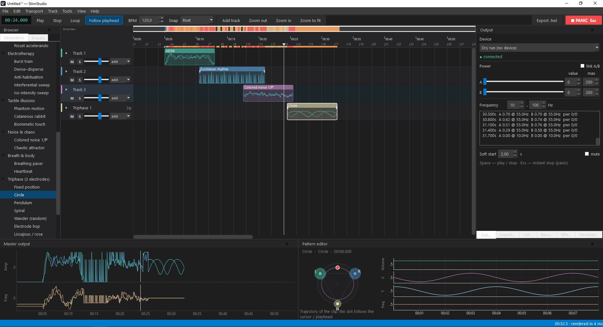
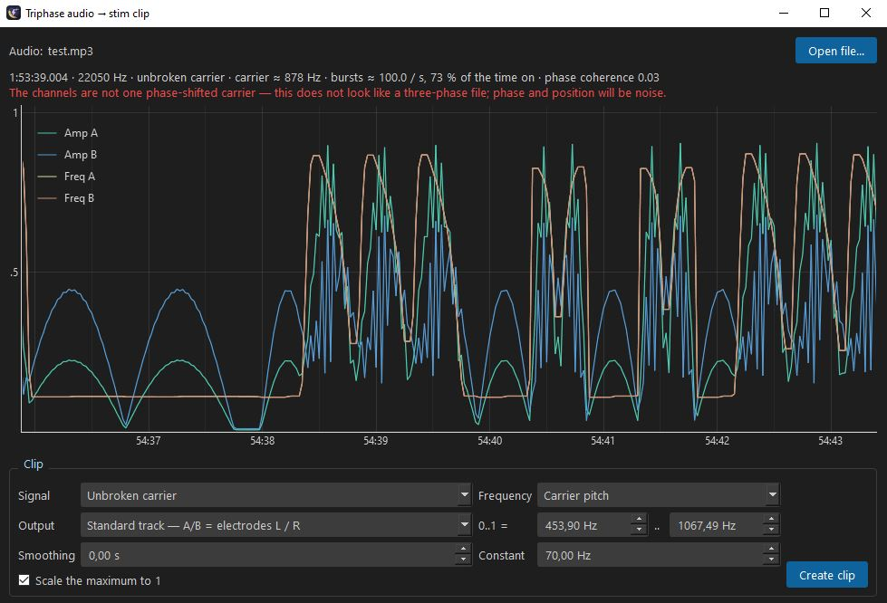
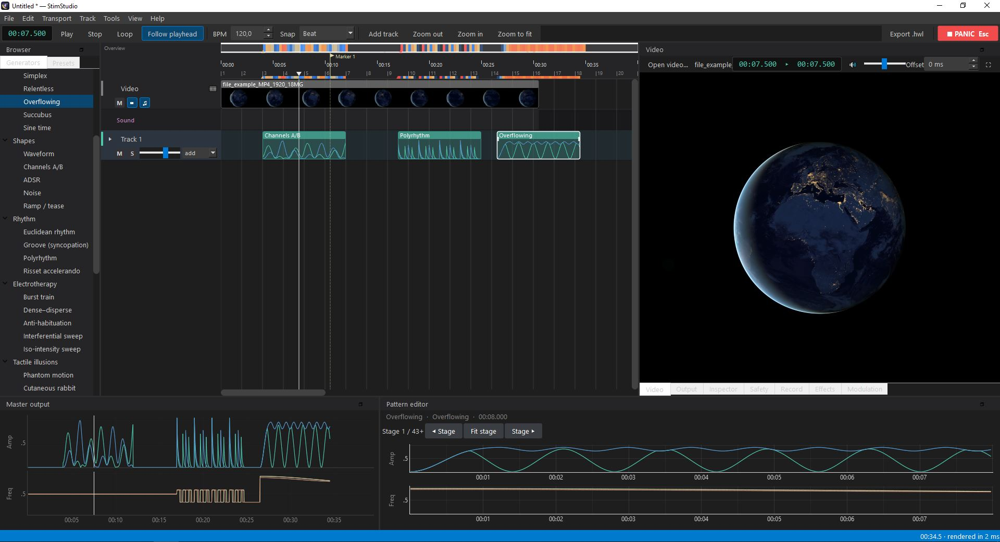

# StimStudio

**A multitrack e-stim pattern studio** in the spirit of LMMS, written in Python + PyQt6.

In StimStudio you build an electrostimulation signal on a timeline from clips, generators and effects. The result can be:

* played on a **DG-Lab Coyote 3 through the [Howl](https://github.com/Amethyst-Sysadmin/Howl) app** (Remote API);
* played on a **sound card** in continuous or wavelet mode, with true three-phase (triphase) stimulation;
* played on **vibrators and other toys through Intiface Central** (Buttplug);
* exported to **`.hwl`** (Howl's native format) or **WAV/FLAC**.

You can write a script to a video, record it live with the mouse, or let the session builder assemble a whole session. The built-in safety check shows sudden jumps and long stretches at the peak.

Version **1.0.0**. Released under the [MIT License](LICENSE).

> **Warning.** Electrical stimulation can injure you. Read [Safety](#safety) before you connect any device. StimStudio is not a medical device, and you use it at your own risk.



---

## Contents

1. [Safety](#safety)
   * [Before you use e-stim](#before-you-use-e-stim)
   * [Disclaimer](#disclaimer)
   * [Safety features in StimStudio](#safety-features-in-stimstudio)
2. [Installation and launch](#installation-and-launch)
3. [Quick start](#quick-start)
4. [Interface](#interface)
5. [Tracks](#tracks)
6. [Clips](#clips)
   * [Clip overlaps and joins](#clip-overlaps-and-joins)
   * [Beat marks and patterns](#beat-marks-and-patterns)
7. [Markers](#markers)
8. [Generators](#generators)
9. [Pattern editor](#pattern-editor)
10. [Presets](#presets)
11. [Effects](#effects)
12. [Automation](#automation)
13. [Audio: conversion and modulation](#audio-conversion-and-modulation)
    * [Triphase audio → stim clip](#triphase-audio--stim-clip)
14. [Video](#video)
    * [Color rhythm: rhythm from shape colours](#color-rhythm-rhythm-from-shape-colours)
15. [Live recording](#live-recording)
16. [Session builder](#session-builder)
17. [Safety check and intensity map](#safety-check-and-intensity-map)
18. [Triphase (three electrodes)](#triphase-three-electrodes)
19. [Playback and output](#playback-and-output)
20. [Export](#export)
21. [Import](#import)
22. [Project, autosave, files](#project-autosave-files)
    * [Media files: relative paths and Collect files](#media-files-relative-paths-and-collect-files)
23. [Keyboard and mouse](#keyboard-and-mouse)
24. [Command line](#command-line)
25. [How the signal is mixed](#how-the-signal-is-mixed)
26. [For developers](#for-developers)
27. [Limitations and untested parts](#limitations-and-untested-parts)
28. [Scientific basis of the generators](#scientific-basis-of-the-generators)
29. [Supporting development](#supporting-development)
30. [Howl compatibility](#howl-compatibility)
31. [Origin of the code](#origin-of-the-code)
32. [License](#license)

---

## Safety

### Before you use e-stim

* **Keep current away from the heart.** Use e-stim only below the waist. Never place electrodes so that current can cross the chest, and never put them on the head or neck.
* **Don't use e-stim** if you have a pacemaker, an implanted defibrillator or another implanted electronic device, a heart condition or epilepsy, or if you are pregnant. If you have any health condition, or any doubt, ask a doctor first.
* **Look after your skin.** Don't put electrodes on broken, irritated or numb skin. Use electrodes and conductive gel made for e-stim, and check your skin after a session.
* **Use a proper e-stim device.** Never connect electrodes straight to a computer, a sound card, headphones or an audio amplifier: the audio outputs must go through an e-stim box with an audio input, made for use on the body.
* **Not while impaired or distracted.** Don't use e-stim while driving or operating machinery, in water, while asleep, or under the influence of alcohol or drugs that dull pain.
* **Start at zero and go slowly.** Begin every session with the power at zero and raise it gradually. Stop at once if you feel pain, burning or numbness.
* **Software can fail.** Keep the device's own power controls within reach and set its hardware limits low. Don't rely on StimStudio alone to keep the levels safe.
* **Adults only, with consent.** Never use e-stim on anyone who hasn't clearly agreed to it.

### Disclaimer

StimStudio is not a medical device. It is not intended to diagnose, treat, cure or prevent any condition, and the research-based generators are not medical protocols. The software is provided "as is", without warranty of any kind (see [LICENSE](LICENSE)). You use StimStudio, and any device it controls, entirely at your own risk; the authors and contributors are not liable for any injury, damage or loss that results from its use.

### Safety features in StimStudio

* **Esc is PANIC.** Instant silence with no fade. It works from any window, including floating docks, modal dialogs and open menus. While output is running, Esc only silences it and the window or menu stays open; the next Esc closes it as usual. The red toolbar button does the same, but under a modal dialog the mouse can't reach it: only Esc works there.
* **File dialogs during output** use Qt's own dialogs, not the system ones: a system dialog doesn't pass keys to the program, so Esc would never reach PANIC.
* **Exporting audio or stems stops the output first** (with the normal fade-out): the export runs on the main thread, and the program doesn't respond to keys until it finishes.
* **A/B power always starts at 0.** The output stays silent until you raise it, and the program reminds you of that. Power values are not saved between sessions.
* **Per-channel limit** (the *max* field): the power slider can't go above it.
* **Soft start** raises the level smoothly at start, over 2 s by default. A normal stop (Space or Stop) fades out over 0.3 s.
* **The Slew limiter effect** limits how fast amplitude can rise. On the master it protects against sudden jumps, triphase tracks included.
* **Safety check** checks the project after every change and warns about serious problems before Play and export; see [Safety check](#safety-check-and-intensity-map).
* Playback never runs longer than 2 hours without pressing Play again.
* Closing the window or changing the device **silences the output**.
* The **Intiface** output hasn't been tested on real devices yet. Raise power gradually.

---

## Installation and launch

You need Python **3.14+**. StimStudio is developed and tested on Python 3.14 under Windows, and the minimum versions of its dependencies are the ones it is tested with.

```
pip install -r requirements.txt  # everything at once: required and optional dependencies, except pytest

# or separately:
pip install -e .                 # dependencies: numpy, PyQt6, pyqtgraph, soundfile, sounddevice, opensimplex
pip install -e .[audio-import]   # optional: soxr/scipy (fast resampling and FFT), librosa (rare audio formats)
pip install -e .[video]          # optional: PyAV — video frames and sound, video analysis
pip install -e .[optical-flow]   # optional: OpenCV — optical flow for "Motion → stim"
pip install -e .[dev]            # pytest

python StimStudio.pyw                   # the editor (or double-click StimStudio.pyw)
python StimStudio.pyw project.stimproj  # open a project
python -m stimstudio gui                # the same
```

`StimStudio.pyw` finds the `stimstudio` package next to itself, so it can be started from any folder: by a double-click, from a shortcut, or from a terminal opened elsewhere. A double-click runs it without a console window; output and crash reports then go to `%LOCALAPPDATA%\StimStudio\StimStudio.log`.

All plots and the timeline are rendered **in hardware through OpenGL**. If OpenGL isn't available (virtual machine, remote desktop), switch to software rendering with the environment variable `STIMSTUDIO_SOFTWARE_RENDER=1`.

---

## Quick start

1. **Add a clip.** Double-click an empty spot on the *Track 1* track: a clip of the generator selected in the browser on the left appears. Or drag a generator or preset from the browser onto the track.
2. **Set up the clip.** Select it: its parameters appear in the **Inspector** dock, and a detailed view in the **Pattern editor** dock at the bottom.
3. **Choose an output.** In the **Output** dock choose a device, for example *Audio (continuous)* or *Coyote 3 via Howl*. For Howl, press **Connect** and raise **A/B power**.
4. **Start playback.** **Space** plays/pauses from the cursor, **Esc** stops immediately.
5. **Save and export.** Ctrl+S saves a `.stimproj` project, **File → Export…** exports `.hwl` or audio.

---

## Interface

| Area | What's there |
|---|---|
| **Toolbar** | Time (cursor or playhead), Play, Stop, Loop, Follow playhead, BPM, grid snap (Snap), Add track, zoom, Export .hwl, **PANIC** |
| **Overview** (above the timeline) | The whole project as one strip: intensity map, markers, safety issues, a frame around the visible area. Click and drag to scroll, wheel to zoom |
| **Song Editor** (centre) | Ruler with markers and an intensity strip, track headers, clips, track lanes (via ▶), cursor, playhead, loop region |
| **Browser** (left) | **Generators** (by category) and **Presets** tabs |
| **Inspector** | Properties of the selected clip: name, start, length, trim, fades, gain, mute, generator, seed, parameters |
| **Effects** | Effect chains: **Track**, **Clip**, **Master** tabs |
| **Modulation** | Modulation routes from audio |
| **Output** | Device, connection, power, output settings |
| **Master output** (bottom) | Preview of the final signal: amplitude and frequency, L/R |
| **Pattern editor** (bottom) | Drawing curves and steps, Howl activity stages, triphase position panel |
| **Video** | The project's video, in sync with the timeline; see [Video](#video) |
| **Record** | Recording a live take with the mouse and keys; see [Live recording](#live-recording) |
| **Safety** | Signal problems found, with Fix / Ignore buttons; see [Safety check](#safety-check-and-intensity-map) |

Docks can be dragged, tabbed together, floated and closed. A closed dock comes back through the **View** menu. The window layout is saved between sessions.

**Menus:**

| Menu | Items |
|---|---|
| **File** | New, Open, Open recent, Save, Save As, Project media…, Open video…, Import audio, Import funscript, Import beat timestamps (CSV), Import .hwl as clip, Import .parthwl clip, Export…, Export .hwl, Export audio, Export clip as .parthwl, Quit |
| **Edit** | Undo, Redo, Cut, Copy, Paste at cursor, Delete, Duplicate, Split at cursor, Glue clips, Mute/unmute clip, Save clip as preset, Select all, Clear all markers |
| **Transport** | Play, Stop, PANIC, Loop, Loop selected clips, Loop between markers, Clear loop region, Record take, Add marker at cursor, Previous / Next marker, Follow playhead |
| **Track** | Add track, Add triphase track, Add modulator track (audio), Duplicate track, Delete track, Session builder…, Video motion → stim…, Detect scene cuts → markers…, Triphase calibration… |
| **Tools** | Utilities in separate windows: Color rhythm from video…, Triphase audio → stim clip…; duplicates of Video motion → stim… and Detect scene cuts → markers… |
| **View** | Zoom, Project overview bar, Video full screen (F11), dock visibility |
| **Help** | Keyboard shortcuts (F1), Support development…, About |

---

## Tracks

| Type | Icon | Lanes (expanded with ▶) | What it does |
|---|---|---|---|
| **Standard** | — | Amp L, Amp R, Freq L, Freq R | A 2-channel signal (A = left, B = right): amplitude and frequency per channel |
| **Triphase** | 3φ | Volume, Position X, Position Y, Pulse freq | The stimulation position in a triangle of three electrodes; see [Triphase](#triphase-three-electrodes) |
| **Modulator** | ♪ | Envelope, Beats/onsets, Low, Mid, High band | An audio file broken down into modulation signals; makes no sound itself |
| **Video** | 🎞 | — | One video clip, shown in the **Video** dock; doesn't go into the stim signal. See [Video](#video) |

**Track header:**
* name (edited in place) and a colour strip;
* **M** (mute) and **S** (solo);
* **gain** — on a modulator it scales the signals;
* **blend mode** into the master: `add`, `max`, `multiply`, `replace` (see [How the signal is mixed](#how-the-signal-is-mixed)).

Right-clicking the header opens a menu: Rename, Color…, Duplicate, **Clip overlaps**, **Smooth joins**, Move up/down, Delete. The tooltip on the track type icon shows the current overlap and join modes.

**Lane headers:**
* `~` — an automation envelope on the lane;
* envelope mode: `×` multiply, `±` offset, `=` replace;
* **M** — lane mute (on triphase only Volume and Pulse freq):
  * on an **amplitude** lane, the track's amplitude on that side doesn't reach the master, but its frequency still takes part in the mix;
  * on a **frequency** lane, the track stops affecting that side's frequency, and the other tracks set it.

  This lets you take amplitude from one track and frequency from another: mute Freq on the first and Amp on the second. Lane mute applies after envelopes and modulation, so a modulation route won't "revive" a muted lane;
* right-click — the envelope curve shape, or deleting the envelope.

Expanded lanes show the **final track signal** after effects, envelopes and modulation.

---

## Clips

**Clip sources:**
* **generator** — parametric, re-rendered on every edit;
* **pulse data** — imported `.hwl`, `.parthwl`, funscript, or audio converted to lanes; turn on *Loop* to repeat the data over the whole clip length;
* **audio file** — only on a modulator track;
* **beat marks** — a blank: only beat times, makes no sound; it is turned into a pattern;
* **pattern** — a container: at each mark it plays one of the clips in its pool (see [Beat marks and patterns](#beat-marks-and-patterns)).

**Actions:**
* add: double-click a track, drag a generator or preset from the browser, or double-click in the browser (the clip lands at the cursor);
* move by dragging, including onto another track of the same type; **Ctrl+drag** copies;
* change the length with the right edge; the left edge **trims the start** — the activity is still simulated from zero, so it stays continuous;
* **fades** — the small squares in the clip's top corners;
* grid snap per Snap: bars, beats, seconds, the 25 ms pulse; edges **stick** to markers and to other clips' edges within 8 px; **Alt** turns snapping off;
* split at the cursor (**S**), glue the selected clips (**Ctrl+J**), duplicate (**Ctrl+D**), mute (**M**);
* copy, cut and paste at the cursor (**Ctrl+C / Ctrl+X / Ctrl+V**);
* delete (**Del**), select all (**Ctrl+A**), rubber-band selection, toggle selection with Shift+click;
* clip right-click: Split here, Glue selected clips, Duplicate, Mute, Save as preset, Delete.

Any action can be undone with Ctrl+Z.

### Clip overlaps and joins

What happens where clips on one track overlap is set by the track's **Clip overlaps** mode (right-click the header):

| Mode | What it does |
|---|---|
| **Crossfade** (default for new tracks) | Clips are layered: the clip that starts later is **on top**. Where it overlaps the one below, its opacity rises smoothly (S-curve) over the whole overlap: one clip hands over to the other, and the levels always add up to 1 — no bump, no dip. Frequency and triphase position meanwhile move smoothly from one clip to the other. A clip **inside** a longer one replaces it, entering and leaving with ramps of *Join length* |
| **Mix (add)** | Clips are summed, capped at 1. This is how all tracks used to work; projects saved before the modes existed open in Mix and sound as before |
| **Max (louder wins)** | At every moment the louder clip plays |

* **To make a crossfade,** slide a clip over its neighbour: the overlap length is the crossfade length. The overlap zone is highlighted and crossed with an X: the solid curve is the upper clip, the dashed one the lower.
* **A manual fade** on an edge that falls inside another clip has no effect in Crossfade mode: the crossfade takes its place, and the fade square on that edge is hidden. Free edges fade as usual.
* Muted (M) clips take no part in overlaps and leave no "holes".

**Smooth joins** smooths butt joints (one clip ends exactly where the next begins). Turn it on with the *Smooth butt joints* checkbox in the same menu; it's off by default. Without it, amplitude, frequency and position jump instantly at the joint, and Safety check catches such jumps. With smoothing, the values move smoothly (S-curve) from the end of one clip to the start of the next within the *Join length* window (0.1–2 s, 0.25 s by default) centred on the joint; outside the window the signal is unchanged. *Join length* also sets the ramp length of a nested clip in Crossfade mode.

**Glue clips** (**Ctrl+J**, the Edit menu or right-click) renders the selected clips of one track into a single clip of finished pulses: fades, clip effects, crossfades and smoothed joins are baked in, and it sounds the same. Handy for moving and copying an assembled fragment as a whole. One Ctrl+Z undoes it; each track needs at least two selected clips.

### Beat marks and patterns

**A beat-marks blank** is a block that stores only beat times and their strength (velocity 0–1). It makes no sound: on the timeline it's hatched, and the beats are vertical ticks whose height is the beat strength. There are two ways to get a blank:

* **From a BeatGen CSV** (File → Import beat timestamps (CSV)… or dropping a `.csv` onto the timeline). The format is described in [docs/BEAT_TIMESTAMPS_FORMAT.md](docs/BEAT_TIMESTAMPS_FORMAT.md). In the dialog you tick the CSV tracks you need; each becomes a new project track (standard or triphase). A `pattern start` … `pattern end` group becomes a separate block, and a run of standalone beats between groups becomes one shared block. A beat with both marks, shared by two adjacent groups, goes into both blocks. So that the blocks don't overlap, the first one ends on that beat, and the beat sounds only in the second. Each block ends one typical (median) interval after its last beat, but no later than the start of the next block. *Time 0 at* is where CSV time 0 sits on the timeline.
* **From a clip's peaks:** right-click a generator or pulse clip → **Beat marks from peaks…**. On the clip's level graph (the max of L/R; on triphase, the volume) you set the level by dragging a line. There are two methods:
  * **Level crossing** — a beat is placed where the signal rises to the level. The next beat is possible only after the signal falls below the level minus *Hysteresis*.
  * **Maxima above level** — beats go on local maxima above the level; of beats close together the strongest stays.

  *Min. interval* drops beats that are too close to each other. The peak height becomes the beat strength. The blank lands on a new track below the clip, or, with *Replace the clip* ticked, replaces the clip itself.

**A pattern** is a container that plays a clip from its **pool** (entries A, B, C…) at every mark. The entries store embedded copies of the clips, so the originals can be changed or deleted without affecting the pattern.

* **Make a pattern:** select the blank together with the clips that should play in it, and choose **Convert to pattern** in its context menu. The selected clips are copied into the pool. You can also convert without clips and fill the pool later.
* **Add to the pool:** select the pattern and clips → right-click the pattern → *Add N selected clips to pattern*. Or in the pattern editor: **+ Generator**, or drag a generator or preset from the browser onto the pool table.
* **Which clip plays on a mark** (*Pick*):
  * **Random (weighted)** — random, with probabilities set by *Weight*. The result is fixed by *Seed*: the same seed always gives the same choice; 🎲 or *New random seed* in the context menu rerolls it.
  * **Sequence** — by a string of keys such as `A B A C`, repeated in a loop; `-` means a rest.
  * **Pin** (right-click a mark) pins a specific clip to the mark, overriding the rule. Pinning doesn't shift the random choice on the other marks.
* **Which point of the clip sits on the mark** (*Anchor*):
  * **Clip start on the mark** (default) — the hit starts on the mark;
  * **Clip middle on the mark** — the middle of the clip falls on the mark;
  * **Clip end on the mark** — the clip ends on the mark, that is, it leads up to the hit.

  Each mark owns a stretch of time around it, its **zone**. Where the zone lies depends on the anchor: for "start" it's the time until the next mark, for "end" the time since the previous one, for "middle" from halfway to the previous mark to halfway to the next. The first mark's zone starts no earlier than the block start, and the last mark's ends no later than the block end. Adjacent zones meet with no gaps or overlaps. Anything before the block start doesn't sound.
* **Clip length on a mark** (*Length*):
  * **Own length, cut at neighbours** (default) — the clip plays its own length, but anything outside its mark's zone is cut off. With the "end" anchor the clip's start is cut, not its end. *Cut fade* sets the fade at the cut.
  * **Own length** — plays in full, and overlaps are mixed per *Overlap*.
  * **Loop to fill** — the clip repeats over the whole zone; the clip's anchor point coincides with the mark.
  * **Stretch to fill** — the clip is stretched or squeezed to fill the whole zone.
* **Velocity depth** — how much the beat strength scales the clip's volume: at 0 the strength has no effect, at 1 a beat with strength 0.5 plays at half volume.
* Patterns work on triphase tracks too; the pool clips are then triphase as well.
* Pattern context menu: **Back to beat marks**, **Bake pattern to pulses** (bake into a pulse clip), **New random seed**. A pattern can be glued (Glue), split (S), copied and exported like a normal clip; into `.parthwl` files and presets it goes already rendered.

**The pattern editor** for blanks and patterns (double-click the clip) shows the marks over the level of the rendered clip:

* **Marks:**
  * double-click adds a mark, with the strength taken from the click height;
  * drag moves a mark (snapping to the *Grid* when *Snap* is on);
  * the top of a tick or Shift+drag changes the beat strength;
  * **Del** deletes; **Ctrl+A** selects all; Ctrl+click adds to the selection;
  * the wheel zooms, dragging empty space scrolls.
* **Quantize** pulls the selected marks (or all of them, if none are selected) to the project's BPM grid with a strength of 0–100 %.
* **Edit ▸** (or double-clicking a pool entry) opens the entry's clip in the normal editor: generator, curves, effects in the inspector and the Effects dock. The **◀ Pattern** button goes back to the pattern.

Any edit can be undone with Ctrl+Z.

---

## Markers

Markers are named points on the timeline: a scene start, a hit, a session phase. Their flags are shown in the top strip of the ruler, and dashed lines run across all tracks.

* **Add:** double-click the ruler, **Shift+M** (at the cursor), video cut detection, the session builder.
* **Move:** drag the flag (on the grid; freely with **Alt**). **Clicking** a flag puts the cursor there.
* **Rename:** double-click the flag. **Right-click:** Go to marker, Loop to next marker, Rename, Colour, Delete.
* **Navigation:** **Ctrl+←/→** — previous / next marker; **Ctrl+Shift+L** — loop between the markers around the cursor.
* **Magnet:** with Snap on, the cursor, the start and end of a dragged clip and envelope points stick to a marker within 8 pixels.
* **Edit → Clear all markers** deletes them all. Markers are stored in the project, and every edit can be undone.

---

## Generators

The 🎲 sign marks a random generator: the result depends on *seed*, and the **New seed** button in the inspector gives a new variant. The ♩ sign marks sync to the project BPM.

### Howl activities
Exact ports of Howl's activities (Kotlin → Python). All 🎲. What each activity represents is described in the Howl wiki's [List of activities](https://github.com/Amethyst-Sysadmin/Howl/wiki/List-of-activities).

| Generator | Parameters |
|---|---|
| Infinite licks | manual mode, speed, lick start/end, lick type, amplitude type |
| Penetration | manual mode, speed, feel |
| Sliding vibrator | hold probability, pulse duration and duty cycle, manual mode, position, frequency |
| Milkmaster 3000 | — (stages) |
| Chaos | cycle duration |
| Luxury HJ | bonus probability, amplitude and timing spread, manual mode, speed |
| Opposites, Calibration 1, Calibration 2, Fast/slow, Relentless, Overflowing, Succubus | — (some have stages) |
| BJ Megamix | manual mode, speed, stage |
| Simplex | preset STANDARD / PRO / TURBO |
| Sine time | manual mode, sine amount and speed, offset, frequency change |

### Shapes
| Generator | What it does |
|---|---|
| **Waveform** | Amplitude and frequency envelopes: shape (sine, triangle, saw, ramp_down, square, pulse), speed, range, duty cycle, phase, A/B phase offset |
| **Channels A/B** | An amplitude shape plus panning between the channels: ping-pong, phase or static |
| **ADSR** | Attack, decay, sustain, release, peak; a frequency shape |
| **Noise** 🎲 | Random curves: smooth, stepped or fractal; the same or different on A/B |
| **Ramp / tease** 🎲 | A build-up along a curve with periodic "tease" dips (rate, length, depth, spread), channel B lag |

### Rhythm
| Generator | What it does |
|---|---|
| **Euclidean rhythm** ♩ | A Euclidean rhythm E(hits, steps) with rotation. Step from 1/2 to 1/16, triplets available. Hit shape: decay, square, sine, ramp_up. Accent on the first beat, hit and rest levels. Channel B: the same, offset or inverted (ping-pong) |
| **Groove (syncopation)** ♩🎲 | A generative rhythm over 16 sixteenth notes with a *Syncopation* knob: 0 puts hits on strong beats, 1 on weak ones. Density, a new variation every N bars, metric accent. Channel B: the same, its own or complementary. Syncopation is medium by default, since that gives the most pleasure (the "inverted U", [Witek 2014](#scientific-basis-of-the-generators)) |
| **Polyrhythm** ♩ | m hits on A against n on B per cycle (3:2, 4:3, 5:4…), accent on the downbeat; *both* mode sends the sum to both channels |
| **Risset accelerando** ♩ | "Endless acceleration" (the rhythmic counterpart of the Shepard tone): 2–4 layers of one pulse with doubling tempo and crossfading. The cycle loops seamlessly. Accelerating and decelerating modes; channel B can go the other way. Freq follows the perceived tempo |

> The newer generators below are based on research into electrostimulation and tactile perception; the sources are listed in [Scientific basis](#scientific-basis-of-the-generators).

### Electrotherapy
| Generator | What it does |
|---|---|
| **Burst train** 🎲 | Bursts (1–4 per second) with a high freq inside and a low one between them, like the burst mode of TENS. Burst length, attack/decay, base level, channel B offset, timing spread |
| **Dense–disperse** | Alternating low and high frequency ("mixed 2/100 Hz") with holds and a smooth transition. Level compensation at high frequency, a dip at the switch, channel B in antiphase |
| **Anti-habituation** 🎲 | Random holds and targets for amplitude and frequency, plus rare "novelty events" (surge, gap, flutter), so the sensation doesn't go stale. *Unpredictability* knob: 0 is even alternation, 1 is fully random. A/B coupling |
| **Interferential sweep** | Amplitude modulation by a "beat" whose frequency itself sweeps across a spectrum (as in interferential therapy). Modes triangle, ramp_up, alternate (6/6); channel B in antiphase. Up to ~15 Hz because of the 40 Hz update rate |
| **Iso-intensity sweep** | A frequency sweep in which the level drops automatically at high frequencies, so the perceived strength stays even. Strength and compensation curve |

### Tactile illusions
| Generator | What it does |
|---|---|
| **Phantom motion** 🎲 | A "phantom" point between electrodes A and B by the energy law (A = I·√(1−β), B = I·√β): the total strength stays constant while the point glides smoothly. Motion ease, sweep, bounce, random. *steps* mode gives discrete virtual points with the Tactile Brush interval (SOA = 0.32·duration + 47.3 ms). Travel width and centre; freq can depend on position |
| **Cutaneous rabbit** | The "rabbit" illusion: short taps on A, then (on the phantom middle and) on B at ~50 ms intervals feel like hops across the skin between the electrodes. Taps per point, interval, tap length, pause, direction |
| **Biomimetic touch** 🎲 | "Touches" coded the way natural receptors do it: a strong burst on press and release (fast-adapting fibres, ∝ rate of force change, higher freq) and a weak background while holding. Touch rate, hold, press/release time, channels both/alternate/random |

### Noise and chaos
| Generator | What it does |
|---|---|
| **Colored noise 1/fᵝ** 🎲 | Noise with spectral slope β: 0 is white, 1 pink, 2 brown. Upper limit on the rate of change, spread, ranges, A/B correlation |
| **Chaotic attractor** 🎲 | Lorenz, Rössler or the logistic map: a deterministic but non-repeating signal (x → amp A, y → amp B, z → freq). Speed and *Character* (calm → wild); seed sets the starting point. The result doesn't depend on the clip length |

### Breath and body
| Generator | What it does |
|---|---|
| **Breathing pacer** 🎲 | An inhale / hold / exhale / hold envelope. Templates: resonance 4:6 (≈ 6 breaths per minute), box 4-4-4-4, 4-7-8, custom. Freq follows the breath, inverted or fixed; tempo drift, B lag. For warm-up and cool-down |
| **Heartbeat** 🎲 | A double "lub-dub" beat with the heart rate moving smoothly from the start value to the end value, with respiratory variability and spread. The interval between the two beats shortens as the rate rises, like a real heart. "lub on A / dub on B" mode |

### Manual
| Generator | What it does |
|---|---|
| **Draw** | A/B curves for amplitude and frequency, drawn with the mouse in the [pattern editor](#pattern-editor) |
| **Step Sequencer** | Per-step values (1–32), hard or smooth transitions, channel B step offset |

### Triphase (triphase tracks only)
| Generator | What it does |
|---|---|
| **Fixed position** | A fixed point (X, Y); it can be dragged on the position panel |
| **Circle** | Rotation in a circle: radius, speed (negative reverses the direction), start angle, radius "breathing" |
| **Pendulum** | Swinging between two angles along an arc or a straight line through the centre; sine, triangle or square shape |
| **Spiral** | Rotation with a radius that "breathes" between an inner and an outer value |
| **Wander** 🎲 | Smooth random wandering, volume variations |
| **Electrode hop** | Moves between electrodes L, R, N and the centre: sequence, step length, transition smoothness |
| **Lissajous / rose** | A Lissajous figure (X:Y ratios and phase) or a rose r = cos(kθ): a dense, slowly changing path across the triangle |
| **Saltation (rabbit)** | The "rabbit" illusion between electrodes: series of short taps hop along the sequence L, R, N, centre |
| **Chaotic attractor** 🎲 | A Lorenz or Rössler attractor projected onto the position disc; the third coordinate drives the volume |

All triphase generators have *Volume* and *Pulse freq* parameters.

### Import
| Generator | What it does |
|---|---|
| **WAV import** | A simplified audio conversion, kept from WaveHowl for compatibility. The main route is [audio import](#audio-conversion-and-modulation) |

---

## Pattern editor

The **Pattern editor** dock at the bottom. Double-clicking a clip opens it on that clip.

* **Draw.** Amplitude and frequency curves are drawn with the mouse on channel A, B or both at once. Tools: Smooth (σ), Flat 0.5, Invert, A → B. The dashed line is the clip's final signal after effects and fades; the part hidden by trimming is darkened.
* **Step Sequencer.** Steps are drawn with the mouse. Tools: Flat, Random, Shift →, A → B. The number of steps is set in the inspector.
* **Howl activities.** A clip preview and blue **stage** markers.
  * **◀ Stage / Fit stage / Stage ▶** trim the clip exactly to a stage.
  * **From start** removes the trim.
  * **Freeze as manual** switches the activity to manual mode with its parameters at the middle of the clip.
* **Triphase clip.** A **position panel** with the path, plus Volume, X, Y and freq graphs; the point follows the cursor or the playhead.
* **Modulator audio clip.** A hint on where to see its signals.

One mouse stroke or one operation is one undo step.

---

## Presets

The **Presets** tab in the browser.

* **Bundled** — built-in presets:
  * Howl: Licks, Milkmaster stage 3, Relentless;
  * Manual: Drawn swell, Step pattern 8;
  * Rhythm: Euclid 3-8 gallop, Euclid 5-8 drive, Euclid 7-16 ping-pong, Groove medium syncopation, Polyrhythm 3-2, Risset eternal accelerando;
  * Shapes: Ping-pong, Slow build with teases, Wandering noise, Warm-up wave;
  * Electrotherapy: Burst train 2 Hz, Dense-disperse 3-3, Anti-habituation long, Interferential sweep 1-10 Hz;
  * Illusions: Phantom glide, Apparent motion steps, Cutaneous rabbit, Biomimetic touches;
  * Noise & chaos: Pink noise, Lorenz drift;
  * Breath & body: Resonance breathing 6 per min, Heartbeat 60 to 110.
* **My presets** — your presets in the `Documents/StimStudio/Presets` folder. **Refresh** and **Open folder** buttons.

Drag a preset onto a track, or double-click it to place it at the cursor. To save the selected clip as a preset, press **Ctrl+Shift+P** or use the clip menu. The format is `.parthwl`, compatible with WaveHowl; see [docs/PARTHWL_FORMAT.md](docs/PARTHWL_FORMAT.md).

---

## Effects

The **Effects** dock has three chains:
* **Track** — effects of the current track;
* **Clip** — effects of the selected clip;
* **Master** — effects after all tracks are mixed.

"**+ Add effect**" adds an effect from a menu sorted by category; ⟿ marks effects with automatable parameters. Each effect card has on/off, the **A/B** channels, the order **▲▼** (effects run top to bottom), delete **✕**, and the parameters.

| Effect | Category | Parameters | Automation |
|---|---|---|---|
| Swap channels | channels | — | |
| Invert frequencies | frequency | — | |
| Phase shift | time | shift (µs) | |
| Frequency adjust | frequency | amount | ✓ |
| Scale amplitude | amplitude | multiplier 0–4 | ✓ |
| Scale frequency | frequency | multiplier 0–2 | ✓ |
| Amplitude feel | amplitude | exponent | ✓ |
| Frequency feel | frequency | exponent | ✓ |
| Amp noise | amplitude | amount, speed, skip zeros, threshold, seed | ✓ (amount) |
| Freq noise | frequency | amount, speed, seed | ✓ (amount) |
| Smooth amplitude / frequency | — | window (s) | |
| **Tremolo** | amplitude | depth, shape, LFO rate, phase, B phase offset, duty cycle | ✓ (depth) |
| **Vibrato** | frequency | the same, for frequency | ✓ (depth) |
| **Tempo gate** ♩ | time | division (1/1…1/16, triplets), open fraction, closed level, edge smoothness, B offset | ✓ (level) |
| **Frequency range** | frequency | lower and upper bound | ✓ |
| **Slew limiter** | safety | max rise (/s), max fall | ✓ (rise) |
| **Triphase pan** | channels | angle, radius, reach | ✓ (angle, radius) |

On triphase tracks the effects act on volume (as on amplitude) and on frequency; they don't touch the position.

---

## Automation

### Lane envelopes
The `~` button in a lane header turns on an envelope. You edit it right on the lane:
* a click adds a point (which you can drag straight away);
* dragging moves a point on the grid, or freely with **Alt**;
* right-clicking a point deletes it;
* points never jump over each other.

Modes: **×** multiplies the lane signal, **±** offsets it (centre 0.5 = no change), **=** replaces it. Curve shape: linear, hold (steps) or smooth.

### Effect parameters
A track effect's card has "**Automate:**" buttons. The parameter gets its own **purple lane** under the track, and the track expands by itself. While an envelope drives the parameter, its field in the form is locked; ✕ in the lane header removes the automation.

All envelope edits can be undone; consecutive edits of one parameter merge into a single undo step.

---

## Audio: conversion and modulation

**File → Import audio…** (Ctrl+I), or drop a file (WAV, FLAC, OGG, MP3, AIFF) onto a track. Processing runs in the background, with progress and a cancel button.

**Import window.** First the program takes a quick look at the file: it reads three 30 s excerpts (one at a random spot in each third of the file; a short file is read whole) and decides whether the file is **three-phase** or **two-channel**. The window shows the verdict and what it's based on:
* **phase coherence** — whether both channels carry one signal (≥ 0.85 for a three-phase file);
* **phase difference** between the channels. A three-phase file keeps it away from 0° and 180°: that is what steers current to the third electrode. The same signal in phase or in antiphase is ordinary stereo;
* the carrier (constant, drifting, or none — music, noise), bursts, an almost silent channel, mono.

Below the verdict are two equal buttons, with the recommended one highlighted:
* **Import as three-phase audio** opens [Triphase audio → stim clip](#triphase-audio--stim-clip) with this file. The clip will land where the file was dropped;
* **Import as two-channel audio** runs the normal conversion (below); the frequency method is picked from the list above the buttons.

The small **Add as modulator…** button makes the file a modulator. If you drop the file straight onto a modulator track, the window isn't shown.

### Convert to stim lanes
Loudness becomes amplitude, and pitch or brightness becomes frequency, separately for L and R. The result is a pulse clip. Frequency estimation methods:
* **Spectral rolloff** — the default, good at telling a bright sound from a dull one;
* **Spectral centroid** — smoother;
* **YIN** — the fundamental, suits melodic material.

The algorithm comes from HWL Viewer; normalisation ignores up to 2 % of outliers.

### Add as modulator
The file lands on a **modulator track ♪**. It makes no sound but outputs 0..1 signals at 40 Hz:
* **Envelope** — loudness;
* **Beats / onsets** — a decaying pulse on every beat or attack;
* **Low / Mid / High band** — energy below 200 Hz, at 200–2000 Hz and above 2 kHz.

Expand the track to see the signals as lanes.

### Triphase audio → stim clip
**Tools → Triphase audio → stim clip…** (a separate window) converts a ready-made three-phase stereo file into StimStudio's format. In such a file both channels carry the same carrier, and the position is encoded by the channel levels and the **phase difference** between them. The normal *Convert to stim lanes* loses the phase; this utility recovers it.



Open the file with **Open file…** or drop it onto the window. The file is demodulated once in the background (about 30 s per hour of audio). After that every setting is recomputed instantly, and the graph shows the result.

The line above the graph shows the duration, the detected signal type, the carrier frequency, the burst rate and the **phase coherence**. Coherence near 1 means a real three-phase file. Below 0.6 the channels aren't one carrier with a phase difference (it's ordinary stereo), and the window warns about it.

| Setting | Options |
|---|---|
| **Signal** | **Auto** (detected from the file); **Unbroken carrier** — a continuous carrier (as in restim): level and phase are averaged over 1/40 s; **Bursts** — carrier bursts: the level is taken at the burst peak and held until the next burst, so it doesn't depend on the duty cycle and doesn't drop out between bursts |
| **Output** | **Standard track — A/B = channel levels**: A = left channel level, B = right, which is exactly what a triphase track sends to Howl; **Standard track — A/B = electrodes L / R**: the current through electrodes L and R with the phase taken into account (the feel on L and R is closer to the original; electrode N is not carried); **Triphase track — volume + position**: volume and position are recovered exactly, taking the project's *Triphase calibration* into account |
| **Frequency** | **Carrier pitch** — the carrier frequency; **Burst rate** — the burst rate; **Constant**. The "0..1 =" field sets which frequencies in Hz become 0 and 1 on the lane. For the carrier the range is set automatically after analysis: the lowest carrier found becomes 0.1 on the lane and the highest 0.9, even if the carrier is nearly constant (you can adjust the range by hand afterwards); without analysis it's 500–1000 Hz, as in continuous audio. For bursts and constant it's 10–100 Hz (as in Howl) |
| **Smoothing**, **Scale the maximum to 1** | Smoothing of level and phase; normalisation that drops up to 2 % of outliers. Without normalisation, 1 corresponds to the file's full scale |

**Create clip** creates a new track (standard or triphase) with a clip starting at the cursor. This is one undo step. The window's settings are remembered.

### Modulation routes
The **Modulation** dock, "**+ Add route**" button. A route sends a modulator's signal to a lane of a standard or triphase track, or to an automatable parameter of one of its effects.

| Mode | Formula (x — value 0..1, s — signal, d — depth) |
|---|---|
| multiply | x · (1 − d + d·s) |
| add | x + d·s (d may be negative) |
| replace | x · (1 − d) + d·s |

Also: **smooth** (smoothing, s) and **invert** (1 − s). A muted modulator turns off its routes.

> The audio file is stored in the project as a path. If the file is moved, the modulator goes silent and the inspector says "file not found".

---

## Video

Video helps you write a script for a clip: the picture runs in sync with the timeline.



**Open:** **File → Open video…** (Ctrl+Shift+O), drop a video file (MP4, MKV, WebM, AVI, MOV, WMV, MPEG) onto the timeline, or use the **Open video…** button in the **Video** dock.

* A **video track** 🎞 appears as the first row, with one clip spanning the whole video. A project has one video: a new file replaces the current one and keeps its position.
* The clip can **only be moved**; that's how the video is lined up with the stim tracks. Length, trim, fades, splitting, copying and effects aren't available for it. You can move the video together with other clips using multi-selection.
* The clip shows a **filmstrip**, and below it a **Sound** lane with the waveform of the video's audio (both are computed in the background and need PyAV: `pip install -e .[video]`).
* Buttons in the video track header: **▦** shows/hides the frames, **♫** shows/hides the sound lane. The choice is remembered.
* The video extends the project length, so playback runs to the end of the video. The video track doesn't go into render, export or stems.
* **M** in the header hides the picture and mutes the video sound.
* Clip right-click: Replace video…, Show video window, Remove video. The **Inspector** shows the path, the duration and a **Replace / locate file…** button (for when the file has been moved).
* If a `name.funscript` (or multi-axis `name.roll.funscript` and the like) lies next to the video, StimStudio offers to import it at the same position.

**The Video dock:**

| Element | What it does |
|---|---|
| Time | Position on the timeline ▸ position in the video |
| 🔊 and volume | Video sound (through the default device). If the stim goes through an audio output, pick a different device for it |
| **Offset** | Picture offset relative to the timeline (±5 s), compensates for output latency |
| ⛶ | Full screen on the monitor the dock is on (you can move the dock to a second monitor); also F11 or double-clicking the picture. In full screen: Space — play/pause, F11 or double-click — exit, **Esc** — PANIC and exit |

**Sync.** The stim output is the clock: during playback the video follows the playhead. A small drift (40–150 ms) is corrected by changing the speed by ±5 %, a large one by seeking (for example, on a loop). When stopped, the video shows the frame under the cursor. Playback needs a selected output; to just watch the video without a device, choose **Dry run**.

The picture is drawn by Qt Multimedia (FFmpeg), with hardware decoding and GPU output where the system supports them.

### Video analysis: cuts and motion

Right-click the video clip → **Motion → stim…** or **Detect scene cuts → markers…** (also in the **Track** and **Tools** menus). Needs PyAV.

* **Region (ROI):** drag a rectangle on the frame, and only motion inside it counts (for example, around the action, without captions). **Whole frame** clears the selection.
* **Analyse** reads the video once in the background (10/20/30 analysis frames per second). The result is cached, so the sliders update the preview instantly.
* **Motion → stim clip:** activity in the region becomes amplitude (smoothing, gamma, range); frequency is constant, "faster motion → higher" or "upward motion → higher". The target is a new standard track (A+B) or a **triphase** track: volume from the activity, and a position that moves up and down with the motion in the frame (towards the bottom electrode N and back). The pulse clip is placed at the video clip's position.
* **Optical flow (OpenCV)** detects the direction of motion more accurately; without OpenCV, phase correlation (numpy) is used.
* **Scene cuts → markers:** hard cuts become "Cut N" markers. **Sensitivity** and **Min. gap** tune the detection; smooth brightness changes and fast motion don't count as cuts.

Everything the analysis creates is undone with one Ctrl+Z.

### Color rhythm: rhythm from shape colours

**Tools → Color rhythm from video…** (a separate window that can stay open). In many videos the rhythm is set by shapes: they fly into a "target" (a ring, a frame) and vanish, or an effect flashes inside it. The utility measures how full the target is and turns that into a pulse clip: amplitude = fill. Needs PyAV.

* **Source** — the project video (**Project video**, the default) or any file (**Open file…**). The slider below the frame (or a click on the graph) picks the frame to view, and **◀ ▶** steps one frame; this doesn't affect the analysis.
* **Zoom:** the mouse wheel zooms towards the cursor (up to ×32; the frame is shown at up to 1080p), the right or middle button pans, and **Fit** returns to the whole frame. This makes it easy to outline a small target: the outline can be as small as 3 pixels of the video frame.
* **Target:** drag around the target **along its outer edge** (blue outline). *Shape* — an ellipse (for rings and circles) or a rectangle. *Measure inside* (70 % by default) — only the inner part of the target is measured (yellow dashes), so the ring outline itself doesn't count as fill. The background colour is taken every frame from a band around the target (dotted outline).
* **Analyse** reads the video once in the background. *Analysis rate* defaults to **All frames**, every frame of the video; a fast rhythm (up to ~10 shapes per second) needs 30–60 frames per second. You can pick a lower rate (15/25/30/60) for speed. The result is cached: switching the mode, colours and thresholds is recomputed instantly, while changing the target, shape or *Measure inside* needs a new analysis.
* **Fill =** what counts as fill:
  * **Anything unlike the surroundings** (default) — everything inside the zone that differs from the background around the target: incoming shapes of any colour and shape. A background change from scene to scene (black → brown → grey) doesn't count as fill. *Difference from* — how much (RGB distance) a pixel must differ from the background; raise it against compression noise and soft glows.
  * **Chosen colours** — the share of the chosen colours. A table of the zone's top colours (sort by clicking a header): *Screen %* — the average share of the zone, *Present %* — the share of time the colour is present (at least *Present from*), *Appearances* — how many times the colour appeared, *Peak %* — its largest share. Colours are chosen with the checkbox, by double-clicking a row or by clicking a colour on the frame (eyedropper; an eyedropper click switches the mode to Chosen colours by itself). The palette has 152 colours (8 greys + 24 hues × 2 saturations × 3 brightness levels).
* **Show what counts** darkens everything on the frame that doesn't count, so you can see at once whether the target and threshold are right.
* **Clip:** *Smoothing*, *Scale the maximum to 1* (fill rarely reaches 100 %), the amplitude range, a constant frequency; in colours mode, *One track per colour* makes one clip per colour.
* **Amplitude from:** *Fill* — the fill itself; *Arrivals* — only rising fill (a shape coming in); *Vanishing* — a sharp peak at the moment the fill drops (the shape arrived and vanished). For a dense rhythm, where the next shape is already on its way, *Vanishing* works better. Short peaks aren't lost when converting to 40 pulses per second: each step takes the maximum.
* **Graph:** the grey line is the measured fill for each analysed frame, the teal line with shading is the amplitude of the future clip (after *Amplitude from*, smoothing, normalisation and range), and the red line marks the frame shown.
* **Beats at 10 per second:** in **Beat marks from peaks…** lower *Min. interval* (0.1 s by default) to ~0.05 s; for *Vanishing* the *Maxima above level* method works well.
* **Create clip** puts the clip on a new track below the video, at the video clip's position; for an external file, at the cursor. Beats are made from it as usual: right-click → **Beat marks from peaks…**.

---

## Live recording

The **Record** dock: the project plays while you perform a take with the mouse, which is handy for writing a script right to the video.

1. Select a standard or triphase track (its header or an empty spot on it).
2. Choose an output (**Dry run** works for recording without a device).
3. Press **R** or **● Record**. Playback starts from the cursor (with a **pre-roll** of 0/2/4 s), and the video is in sync.
4. Perform on the pad, then press **R**, Stop or Space: the take becomes a "Take N" pulse clip.

| Pad | Input |
|---|---|
| **Standard track** | Left button held: up is level, right is frequency. Releasing returns the level to 0 (or holds it if *Hold level on release* is on). Keys **1–9** — 10–90 %, **0** — silence. Wheel — frequency. **Channels**: A+B, A only, B only |
| **Triphase** | The electrode triangle: dragging sets the position, the wheel and keys set the volume, **Pulse freq** sets the frequency |

* **Monitor** — the output plays exactly what you perform (the other tracks aren't heard while recording). Power, soft start, mute and **PANIC** work as usual. Howl Remote doesn't support monitoring (it plays the whole file).
* **Punch in** — record only inside the loop region; with Loop on, every pass overwrites the previous one.
* **Smoothing** smooths the take (40 ms by default).
* A new take **mutes** the earlier takes under it instead of deleting them: bring an old one back with **M**. The whole take is undone with one Ctrl+Z.

---

## Session builder

**Track → Session builder…** assembles a whole session from a few choices:

| Parameter | What it sets |
|---|---|
| **Length**, **Starts at** | The duration (the video length or 20 min by default) and the start on the timeline (the video start by default) |
| **Style** | Mixed (calm → rhythm → wild), Smooth, Rhythmic, Unpredictable, Tease (build-ups with dips before the peak) |
| **Peak level** | The maximum of the intensity arc (0..1, before output power) |
| **Build-up waves**, **Phases** | The number of build-up waves, the warm-up and cool-down shares |
| **Triphase tracks** | A session made of triphase generators |
| **Clip lengths in whole bars** | Clip lengths are multiples of a bar |
| **Snap phases to markers** | Phase boundaries snap to markers (for example, to video cuts) |
| **Variation / Re-roll** | Another variant with the same settings |

The result:
* the phases *Warm-up → Build 1…N → Peak → Cool-down*, with **markers**;
* two tracks, *Session A/B*, with alternating generator clips (20–60 s, parameters slightly varied) and crossfades;
* an **intensity envelope** on the amplitude lanes and a **Slew limiter** on each track.

The preview shows the arc, the phases and the clip boundaries. Everything is created as one undo step and can then be edited as usual.

---

## Safety check and intensity map

The check runs after every render. Its result is shown in the **Safety** dock and as triangles on the ruler and on the Overview strip.

| Problem | When | Severity |
|---|---|---|
| **Sudden jump** | The level rises within 0.1 s by more than 0.4 above the peak of the previous 2 s (repeated hits at the same level don't count; a hit after silence does) | serious from 0.7 |
| **No warm-up** | After 3 s of silence (or at the start) the level rises above 0.5 within 2 s | warning |
| **Long at the top** | The average level stays above 0.85 for more than 90 s without a pause | warning |
| **Low rate at high level** | The pulse rate is below 15 Hz at a level above 0.8 for more than 2 s | warning |
| **Position jump** | The triphase position moves by more than 0.5 within 0.1 s at an audible volume (series of jumps are merged) | warning |
| **Total intensity** | More than 40 % of the project is above 0.7 | note |

* **Clicking** a row puts the cursor at the problem and selects the clip.
* **Fix** (or double-click): for a jump or a missing warm-up, a **Slew limiter** on the source track (or on the master); for a long peak, short "breather" dips in the amplitude envelope.
* **Ignore** hides a specific problem (stored in the project), **Show ignored** brings them all back.
* **Before Play and export**, if there are serious problems, a question appears: *Play/Export anyway*, *Add master limiter*, *Show issues* or *Cancel*. The *Don't ask again for this project* checkbox turns the question off for the project.

**The intensity map** is the strip under the ruler and the **Overview** row above the timeline, coloured from dark blue (quiet) through yellow to red (maximum). **View → Project overview bar** hides the overview.

These are heuristics, not a medical assessment: the thresholds are chosen for typical e-stim sensations and don't replace caution.

---

## Triphase (three electrodes)

**Wiring:**
* **Howl / Coyote 3:** channel **A → electrode L**, channel **B → electrode R**, both returns → **common electrode N**.
* **Audio:** left channel → L, right → R, ground → N.

**How it works.** The position in the circle (electrodes: N at the bottom, L at the top left, R at the top right) sets how much current goes through each electrode.
* At the **centre** you get balanced three-phase: all three electrodes get the same.
* **Moving towards an electrode** doubles the current through it relative to its neighbours.
* **Moving towards the middle of a side** weakens the opposite electrode.

**What each output gets:**
* **Continuous audio** plays a **true phase signal**: both channels run on a common carrier, each with its own amplitude and phase. The carrier pitch is set by the *Pulse freq* lane through the output's frequency range.
* **Howl, wavelet and `.hwl`** get only the channel amplitudes, without phase: pulse outputs don't carry phase.

**Tools:**
* **Track → Add triphase track**, then the generators of the *Triphase* section.
* **The position panel** in the pattern editor: the electrode triangle, the path, the point, and electrodes that glow in proportion to their current.
* **Track → Triphase calibration…**: centre offset, gain of electrodes N, L and R, and **reach** (how far the edge of the circle shifts the current). The calibration is stored in the project and can be undone.
* The **Triphase pan** effect spreads a standard track across the triangle.
* **Tools → Triphase audio → stim clip…** converts a ready-made three-phase audio file into a standard or triphase clip; see [Triphase audio → stim clip](#triphase-audio--stim-clip).

---

## Playback and output

### Transport
* **Space** — play/pause from the cursor. Clicking the timeline during playback seeks the output.
* **Stop** — stop with a 0.3 s fade; **Esc** — instant silence.
* **Loop:** **L** toggles it; dragging with the right mouse button along the ruler sets the region; right-clicking the ruler clears it; **Ctrl+L** loops the selected clips. If no region is set, the whole project loops.
* **F** — follow the playhead.
* Edits reach a running output with the next render (usually in under 0.1 s).

### Devices (Output dock)
| Device | Connection | Notes |
|---|---|---|
| **Coyote 3 via Howl (remote)** | Howl on the phone, with remote access turned on in its settings. Host (or **Scan** — a search of this PC's subnet), port, access key, then **Connect**. See [Howl compatibility](#howl-compatibility) | Howl receives the rendered `.hwl` in one piece; after edits it reloads by itself (with a delay). Power and mute are sent live, and power changed on the phone shows up in the panel. There's an option to swap channels A↔B |
| **Audio (continuous)** | Sound card (device choice); connects by itself on Play | A continuous tone whose pitch follows the frequency lane (500–1000 Hz). Shape: sine, square, triangle, trapezoid. Triphase with phase |
| **Audio (wavelet)** | Sound card | Short carrier bursts (Hz, number of periods, fade), repeated at the pulse rate (10–100 Hz) |
| **Intiface / Buttplug (vibrators)** | Intiface Central on this PC (or on the network): start its server, enter the address (`ws://127.0.0.1:12345` by default), **Connect**, and **Scan** if needed | The channel level (with power, soft start and mute) goes to the toys 10 times per second. For each device you choose what it follows: A, B, the louder of A/B, or nothing (remembered by device name). The pulse frequency isn't sent. Stop, PANIC, a lost connection and closing the program stop all devices |
| **Dry run** | No device | A log of the frames sent |

**Common settings:**
* **A/B power** (0–200) with **limits** and *link A/B*;
* **frequency range** (Hz) — what the normalised frequency 0..1 is turned into;
* **soft start**, **mute**.

The Howl address and key, the limits and soft start are remembered between sessions.

---

## Export

**File → Export…** (Ctrl+Shift+E):
* **format:** `.hwl`, WAV or FLAC (24-bit);
* **range:** the whole project, the loop region, or the span under the selected clips;
* **output:** the **mix** as one file, or **stems**, one file per track (`<project> - 01 <track>.hwl`). Each stem is rendered solo, so master effects and modulation are kept in it;
* **audio:** continuous or wavelet mode, a sample rate of 44.1, 48 or 96 kHz, and optionally the settings from the Output dock.

Audio export runs the same synthesis as the live output: the file matches what the sound card would have played, sample for sample (without soft start).

**Quick actions:**
* **Export .hwl** (Ctrl+E) — the whole mix;
* **Export audio** — with the Output dock settings;
* **Export clip as .parthwl** — the selected clip.

An exported `.hwl` plays in Howl; see [Howl compatibility](#howl-compatibility).

---

## Import

| What | How | Result |
|---|---|---|
| Audio | File → Import audio, drag and drop | A pulse clip or a modulator track |
| **Funscript** | File → Import funscript, or drop a `.funscript` | A pulse clip. Single-file scripts, `name.roll.funscript` sets and containers with an `axes` field (axes L0, L1, L2, R0, R1, R2, V0, V1, V2) are supported. Each of the clip's 4 columns can be taken from any axis (position or speed, invert, min/max) or set to a constant. Interpolation linear, smooth or hold; offset in ms. On a triphase track the columns are volume, X, Y and frequency |
| **Beat marks (CSV)** | File → Import beat timestamps (CSV), or drop a `.csv` | Tracks with blank blocks: a `pattern start…end` group is one block, a run of standalone beats is one block. See [Beat marks and patterns](#beat-marks-and-patterns) |
| `.hwl` | File → Import .hwl as clip | A pulse clip |
| `.parthwl` | File → Import .parthwl clip, presets | A generator clip (WaveHowl files) or a pulse clip (HWL Viewer files); WaveHowl effects are converted |

---

## Project, autosave, files

* **`.stimproj`** — the project as JSON: tracks, clips, envelopes, effects, modulation routes, triphase calibration, BPM, markers, hidden safety issues. Pulse data is stored inside the file; video and audio are stored as links to the files (see below). Saving is atomic: a crash in the middle of writing doesn't corrupt the file.
* **Autosave** every 2 minutes into the application data folder, not over your file. After a crash, the program offers to restore your work on the next start; after a normal save or close the copy is deleted.
* **File → Open recent** — the last 8 projects.
* **Undo** covers everything: clips, tracks, parameters, effects, envelopes, modulation, calibration.
* `.hwl` is Howl's native format: a `YEAHBOI!` header and 4 × float32 per pulse (40 pulses per second). See [Howl compatibility](#howl-compatibility).

### Media files: relative paths and Collect files

Video, modulator audio and *WAV import* generator files aren't copied into the project: the project stores links to them. Each link is written twice:
* a **relative path** from the project folder (with forward slashes, for example `media/movie.mp4`);
* the **absolute path** at save time, as a fallback.

On opening, the relative path is tried first, then the absolute one. So a project can be moved together with its media folder (to another drive or computer), while a project file copied on its own still finds the media in the old place. A file on a different drive from the project is stored only as an absolute path. Old projects with absolute paths open as before.

**File → Project media…** lists all the project's files: type, which clips use them, size, status (*OK*, *OK · in project folder*, *Missing*) and folder.
* **Collect files…** copies all the files into one folder next to the project (`media` by default), switches all clips to the copies and, if you like, saves the project right away. The originals aren't touched. Files that already lie inside the project folder stay where they are; different files with the same name get a ` (2)` suffix; files copied earlier (same size and content) aren't copied again. Copying runs in the background with progress and cancel, and never leaves a half-copied file behind. Undo (Ctrl+Z) switches the clips back to the originals; the copies stay on disk.
* **Find missing in folder…** searches the chosen folder and its subfolders for missing files by name.
* **Locate…** (or double-click) points the selected file to its new location; if other missing files turn up in the same folder, the program offers to relink them too.

If some files are missing when a project opens, the program says so right away and offers to find them. Autosave stores paths relative to the real project file, so restored work finds its media.

---

## Keyboard and mouse

The full list is in **Help → Keyboard shortcuts (F1)**.

| Key | Action |
|---|---|
| **Space** | Play / Pause |
| **Esc** | **PANIC** — instant silence |
| L / Ctrl+L | Loop on/off / loop the selected clips |
| F | Follow the playhead |
| S | Split at the cursor |
| Ctrl+J | Glue the selected clips |
| M | Mute the clip |
| Ctrl+D | Duplicate |
| Ctrl+C / Ctrl+X / Ctrl+V | Copy / cut / paste at the cursor |
| Del | Delete |
| Ctrl+A | Select all |
| Ctrl+Z / Ctrl+Y (Ctrl+Shift+Z) | Undo / redo |
| Ctrl+T | Add a track |
| Ctrl+= / Ctrl+- / Ctrl+0 | Zoom in / zoom out / fit the project |
| Ctrl+N / Ctrl+O / Ctrl+S / Ctrl+Shift+S | New / open / save / save as |
| Ctrl+I | Import audio |
| Ctrl+Shift+O | Open video |
| F11 | Video full screen (Esc — PANIC and leave full screen) |
| R | Record a take (Record dock) |
| Shift+M | Marker at the cursor |
| Ctrl+← / Ctrl+→ | Previous / next marker |
| Ctrl+Shift+L | Loop between the markers around the cursor |
| Ctrl+E / Ctrl+Shift+E | Export .hwl / export dialog |
| Ctrl+Shift+P | Save the clip as a preset |
| F1 | Keyboard reference |

| Mouse | Action |
|---|---|
| Double-click a track | Add a clip |
| Drag a clip / Ctrl+drag | Move / copy |
| Clip edge | Length and start trim |
| Squares in the clip's corners | Fades |
| Alt while dragging | No snapping to the grid, markers and clip edges |
| Slide a clip over its neighbour | A crossfade as long as the overlap (Crossfade mode) |
| Click empty space or the ruler | Cursor |
| Right-drag along the ruler / right-click it | Set / clear the loop region |
| Ctrl+wheel / Shift+wheel / wheel | Zoom / horizontal / vertical scroll |
| Video file onto the timeline | Open the video (adds a video track) |
| Double-click the ruler / a marker flag | Add a marker / rename it |
| Drag a flag / click / right-click | Move the marker / cursor to the marker / marker menu |
| Overview strip: click, drag / wheel | Scroll / zoom |
| Record pad: button held, wheel, 1–9, 0 | Level and frequency (position) / frequency (volume) / level / silence |
| Double-click the video clip / the picture | Video dock / full screen |
| Click a lane with an envelope / right-click a point | Add / delete a point |
| Drag files from Explorer | Import audio or funscript onto a track |

---

## Command line

```
python -m stimstudio demo  out/                                    # demo project + .hwl
python -m stimstudio render project.stimproj out.hwl               # mix to .hwl
python -m stimstudio render project.stimproj out.wav --mode wavelet --rate 44100
python -m stimstudio render project.stimproj part.hwl --start 30 --end 90
python -m stimstudio stems  project.stimproj folder/ --format flac # one file per track
python -m stimstudio info   file.hwl|.parthwl|.stimproj            # summary
python -m stimstudio gui    [project.stimproj]                     # the editor
```

---

## How the signal is mixed

1. **Clip:** the source (generator or data), then the clip effects, gain and fades.
2. **Track:** clips are combined per the *Clip overlaps* mode — crossfade, sum or maximum (frequency and position weighted by amplitude); with *Smooth joins* the joints are smoothed; then the track effects, lane envelopes and modulation routes. Outside clips the track is silent.
3. **Master:**
   * amplitude — per the track's mode: `add` (sum capped at 1), `max`, `multiply` (a gate for the tracks below), `replace` (overrides the tracks below);
   * frequency — the amplitude-weighted mean; in silence the last frequency holds;
   * a lane mute removes only its own part from the mix: a track with muted amplitude affects frequency with the weight its amplitude would have given, and a track with muted frequency affects only amplitude. If frequency is muted on every sounding track, the last frequency holds. A muted amplitude takes no part in `multiply` / `replace` either;
   * then gain, mute and solo apply, followed by the master effects.
4. **Triphase tracks:**
   * for `.hwl`, Howl and wavelet they're converted to A/B amplitudes and mixed like standard tracks;
   * for continuous audio they're synthesised separately, with phase.
5. **Frequency** in the lanes is normalised to 0..1. Each output converts it to Hz with its own frequency range.

Rendering runs in the background on a snapshot of the project and caches expensive clip sources, so the interface never blocks.

---

## For developers

| Package | Contents |
|---|---|
| `stimstudio/core` | `pulse` (an `(N, 4)` array at 40 Hz), `model`, `mixer`, `joins` (clip overlaps and joins), `media` (file paths, Collect), `automation`, `render`, `triphase`, `export`, `safety` (signal check), `record` (takes), `session` (session builder) |
| `stimstudio/engine` | A port of Howl's activity engine (a separate RNG per stream) |
| `stimstudio/generators` | The generator registry (`ParamSpec`, `domain`, `tempo_synced`) |
| `stimstudio/effects` | The effect registry, chain, automatable parameters, fades |
| `stimstudio/audio` | Audio loading, conversion to lanes, analysis for modulation, three-phase audio demodulation (`triphase_decode`) |
| `stimstudio/outputs` | Outputs: audio, Howl Remote, Intiface (`buttplug` with its own WebSocket client `wsclient`), dry run; offline audio render |
| `stimstudio/io` | `.hwl`, `.parthwl`, `.stimproj`, presets, funscript, video (`video`, `video_analysis`) |
| `stimstudio/gui` | The document (model, undo, background render), commands, Song Editor, Pattern editor, panels |
| `tools/make_presets.py` | Rebuilds the bundled presets |

The core (`core`, `generators`, `effects`, `audio`, `io`, `outputs`) doesn't depend on Qt and is tested without the interface.

```
python -m pytest           # 872 tests
```

The GUI tests run without a screen: the Qt offscreen platform, software rendering, settings in a temporary ini file (not the registry), autosave in a temporary folder. Some tests compare results with the original projects:
* the generators match WaveHowl bit for bit;
* the effects match the HWL Viewer reference (`tests/data/golden.npz`);
* the frequencies in audio conversion match `hwlfromaudio`.

The WaveHowl and HWL Viewer sources aren't in the repository. The tests that need them look for them in a local `NotInclude/External Data` folder and are skipped without it. The `golden.npz` reference is in the repository, so the effects check always runs.

---

## Limitations and untested parts

* **Hardware testing is partial.** The Howl Remote output has been tested with the Howl app on a phone. The audio output has been checked by generating the signal, but not by playing it on a sound card, and Intiface only against a simulated server (see below).
* **The triphase model was derived independently** from the three-electrode circuit rather than taken from restim. It is physically consistent (tests), but the sensations haven't been checked; adjust the calibration if needed.
* **Howl doesn't accept a stream:** after edits the file is reloaded whole, so live changes arrive with a delay.
* **The Pulse freq lane has two roles** on a triphase track: the carrier pitch in continuous audio and the pulse rate for Howl. There's no separate lane for the carrier.
* **Wavelet audio and `.hwl`** carry triphase without phase.
* **Triphase audio** has been tested on synthetic files and on StimStudio's own continuous render, but not on third-party three-phase files. The position is recovered in StimStudio's electrode model. If a file was made with a different model (for example, in restim), the sensations may differ slightly, and points beyond the physical limit of the model move to the edge of the circle.
* **Effect parameter automation** exists only on tracks: clips and the master don't have it.
* **Master effects** act on triphase volume and frequency, but not on position.
* **Media files** aren't embedded in `.stimproj`: links are stored (relative and absolute); use *Collect files* to move a project. File paths inside presets (`.parthwl` with WAV import) stay absolute.
* **Glue** bakes the sound of the clips as they mix with each other; if the glued clips overlapped unselected ones, the result at those joints may differ slightly.
* **Video sync** has been checked by logic tests against a player model, but not with live playback on a real output; adjust the output latency with the **Offset** field.
* **Intiface** has been tested against a simulated server (Buttplug protocol v3), but not with a real Intiface Central and toys.
* **Live recording** has been tested against a model. The monitor latency depends on the output: tens of milliseconds for audio, about 0.1 s for Intiface. Howl Remote doesn't support monitoring.
* **Video analysis** is heuristic: cuts are found by changes in the histogram and frame structure, motion by frame difference and phase correlation (or optical flow). On real videos, adjust Sensitivity and the region.
* **Safety check** uses heuristics with fixed thresholds; it is not a medical assessment.

---

## Scientific basis of the generators

The generators in the Electrotherapy, Tactile illusions, Noise and chaos, and Breath and body groups, as well as Groove and Risset, are built on ideas from the works below. They are inspiration for patterns, not medical protocols: the research was done with TENS devices, vibration motors and neural interfaces, and the transfer to e-stim hasn't been tested.

| Generator | Idea | Source |
|---|---|---|
| Burst train | Bursts of high-frequency pulses 1–4 times per second (burst TENS) | [electrotherapy.org — TENS](https://www.electrotherapy.org/tens) |
| Dense–disperse | A mixed 2/100 Hz frequency cut the need for painkillers by 53 %, against 32–35 % for a single frequency; alternation delays tolerance | [Hamza et al. 1999](https://pubmed.ncbi.nlm.nih.gov/10551571/); [DeSantana et al. 2008](https://pmc.ncbi.nlm.nih.gov/articles/PMC2744433/) |
| Anti-habituation | Random frequency modulation reduces habituation compared with a fixed frequency; novelty restores the response | [Phys Ther 2019](https://academic.oup.com/ptj/article-abstract/99/7/924/5421643); [Rankin et al. 2009 — Habituation revisited](https://www.sciencedirect.com/science/article/abs/pii/S1074742708001792) |
| Interferential sweep | The beat of two carriers gives amplitude modulation, and its frequency sweeps across a "spectrum" | [Physiopedia — Interferential Therapy](https://www.physio-pedia.com/Interferential_Therapy); [MDPI 2022](https://www.mdpi.com/1648-9144/58/1/141) |
| Iso-intensity sweep | To keep the sensation the same, the level must drop as the pulse frequency rises | [JNER 2015](https://jneuroengrehab.biomedcentral.com/articles/10.1186/s12984-015-0022-8); [CHI 2022 — Electrotactons](https://dl.acm.org/doi/abs/10.1145/3491102.3501863) |
| Phantom motion | Funneling / phantom sensation, the energy model and the apparent-motion SOA (Tactile Brush) | [Israr & Poupyrev, CHI 2011](https://www.researchgate.net/publication/221518352_Tactile_Brush_Drawing_on_skin_with_a_tactile_grid_display); [Funnelectro 2025](https://dl.acm.org/doi/10.1145/3771882.3771890) |
| Cutaneous rabbit | Saltation: taps 40–80 ms apart "hop" between points | [Scholarpedia — Cutaneous Rabbit](http://www.scholarpedia.org/article/The_Cutaneous_Rabbit_Effect:_Phenomenology_and_saltation); [Wikipedia](https://en.wikipedia.org/wiki/Cutaneous_rabbit_illusion) |
| Biomimetic touch | Bursts at the start and end of contact feel more natural | [Valle et al. 2018, Neuron](https://www.sciencedirect.com/science/article/pii/S0896627318307384); [George et al. 2019, Sci Robot](https://www.science.org/doi/10.1126/scirobotics.aax2352) |
| Colored noise | Subthreshold pink noise works better than white (stochastic resonance) | [Neurosci Lett 2023](https://www.sciencedirect.com/science/article/abs/pii/S0304394023000563); [Gait Posture 2022](https://www.sciencedirect.com/science/article/abs/pii/S0966636222000583) |
| Chaotic attractor | Chaotic signals as an alternative to noise | [Gait Posture 2022](https://www.sciencedirect.com/science/article/abs/pii/S0966636222000583) |
| Groove | Medium syncopation gives the most pleasure (an inverted U) | [Witek et al. 2014, PLoS ONE](https://journals.plos.org/plosone/article/file?id=10.1371/journal.pone.0094446&type=printable) |
| Risset accelerando | Eternal acceleration: layers with doubling tempo and crossfading | [Stowell 2011 / overview](https://github.com/nathanturczan/risset); [Shepard tone](https://en.wikipedia.org/wiki/Shepard_tone) |
| Breathing pacer | Resonance breathing at ~0.1 Hz (6 breaths per minute) maximises heart rate variability | [Clin Neurophysiol 2019](https://www.sciencedirect.com/science/article/abs/pii/S1388245719313021); [Vaschillo tribute, PMC](https://pmc.ncbi.nlm.nih.gov/articles/PMC9088144/) |
| Heartbeat | Heart-rate feedback changes how arousal is rated (Valins 1966) | Valins S. (1966), *J Pers Soc Psychol* 4(4) |

---

## Supporting development

At every launch one of two windows opens:
* **the support window**: the funding goal, buttons for the donation platforms, crypto wallets with a **Copy** button, and a nickname field;
* **the thank-you window**, if your nickname is on the list of confirmed donors. It closes by itself after 3 s or with the **I am a hero** button.

You can open the support window by hand with **Help → Support development…**. There you can also change or clear the nickname.

* **Network.** The window's content and the donor list are loaded in the background from the project site (`donate.yml` and `Heroes.csv` on `raw.githubusercontent.com`), which doesn't delay the program's start. The nickname isn't sent to the server: it's checked against the downloaded list on your computer. A new donor appears on the list after a delay of up to a few minutes.
* **Without a network** the support window isn't shown. A confirmed donor still sees the thank-you window.
* **The nickname** is stored in `~/.pppstimer/donor.json`. The file is shared by all programs that use this folder, so you only need to enter the nickname once.
* **Safety.** The windows don't block the main window, so **PANIC** works while one is open. **Esc** in them acts as PANIC and doesn't close the window. If output is already running at startup, the window waits until it stops.

---

## Howl compatibility

[Howl](https://github.com/Amethyst-Sysadmin/Howl) is an open-source Android app that controls e-stim devices (including the DG-Lab Coyote 3) and generates patterns. StimStudio reads and writes Howl's file format, uses ports of its algorithms and can play through it. StimStudio is an independent project and is not associated with Howl or its author.

| What | How StimStudio uses it |
|---|---|
| **`.hwl` files** | Howl's native pulse format. StimStudio writes it (**File → Export…**, **Export .hwl**, `python -m stimstudio render`) and reads it (**File → Import .hwl as clip**). Layout: the 8-byte ASCII header `YEAHBOI!`, then 4 × float32 little-endian per pulse — amplitude L, amplitude R, frequency L, frequency R, each 0..1 — at 40 pulses per second, with no other header. An exported file opens in Howl's **Player** (folder button) like any other HWL file, and an HWL file recorded or converted with Howl imports as a pulse clip |
| **Pulse rate and values** | The whole engine runs at Howl's (and the Coyote 3's) rate of 40 pulses per second. Frequency in the lanes and in `.hwl` is normalised to 0..1; Howl turns it into Hz with its frequency range slider, and StimStudio's outputs do the same with their **frequency range** setting |
| **Activities** | The generators in [Howl activities](#howl-activities) are Kotlin → Python ports of Howl's activities (`Activity.kt`) and of the engine behind them (`ActivityComponents.kt`, `CyclicalWave.kt`, `Utils.kt`), stages included. Howl's wiki describes them: [List of activities](https://github.com/Amethyst-Sysadmin/Howl/wiki/List-of-activities) |
| **Audio output** | *Audio (continuous)* and *Audio (wavelet)* are based on the two audio output modes Howl offers for e-stim boxes with an audio input ([Howl wiki: Audio output](https://github.com/Amethyst-Sysadmin/Howl/wiki/Audio-output)). StimStudio adds triphase with phase to continuous mode |
| **Funscript** | StimStudio's funscript import (from HWL Viewer) maps the script's axes onto lanes, as described in [Import](#import). It is not Howl's positional funscript algorithm; for that, play the `.funscript` in Howl itself |
| **Output through Howl** | *Coyote 3 via Howl (remote)* controls the Howl app over its remote access API (below) |

### Playing through Howl

1. Install Howl on an Android phone (APK on Howl's [Releases](https://github.com/Amethyst-Sysadmin/Howl/releases) page) and connect the Coyote 3 to it.
2. In Howl's settings, under [Remote access options](https://github.com/Amethyst-Sysadmin/Howl#remote-access-options), turn on **Allow remote access** and set a **Remote access key**.
3. Put the phone and the PC on the same Wi-Fi network.
4. In StimStudio's **Output** dock choose **Coyote 3 via Howl (remote)**, enter the phone's address (or press **Scan this PC's subnet for Howl**), the port (4695 by default) and the key, then press **Connect**.
5. Raise **A/B power** and press Play.

An HTTP round trip to a phone is too slow and jittery for 40 Hz packets, so StimStudio doesn't stream pulses. It sends the rendered mix to Howl once, as an `.hwl` file (`/load_hwl`), and Howl plays it locally. After that StimStudio only pushes power, mute, frequency range and channel swap live, and polls `/status` for the playback position and for changes made on the phone. After edits the file is sent again, so changes arrive with a delay. The endpoints follow the reference client in Howl's repository, [`remote_control/howl_remote.html`](https://github.com/Amethyst-Sysadmin/Howl/tree/master/remote_control).

* The key travels in plain text (HTTP bearer authentication). As Howl's documentation warns, don't use remote access on networks you don't trust.
* Triphase tracks reach Howl as channel amplitudes only, without phase. Wire channel A to electrode L, channel B to electrode R, and both returns to N (see [Triphase](#triphase-three-electrodes)).

---

## Origin of the code

StimStudio combines and builds on:
* **[Howl](https://github.com/Amethyst-Sysadmin/Howl)** — the activity algorithms, output formulas, the `.hwl` format, the Remote API (see [Howl compatibility](#howl-compatibility));
* **WaveHowl** — generators, the activity engine, the `.parthwl` format, the Draw/Steps editors;
* **HWL Viewer** — output (audio, Howl Remote), 12 effects, audio conversion, funscript.

The WaveHowl and HWL Viewer sources aren't included in this repository.

---

## License

StimStudio is released under the [MIT License](LICENSE).

Parts of StimStudio are ported from [Howl](https://github.com/Amethyst-Sysadmin/Howl), whose original code is released under the MIT License. Howl's license adds one condition: a distribution of Howl or any part of it, with or without changes, may not use the name Howl or a very similar name. StimStudio is not associated with the Howl project.
